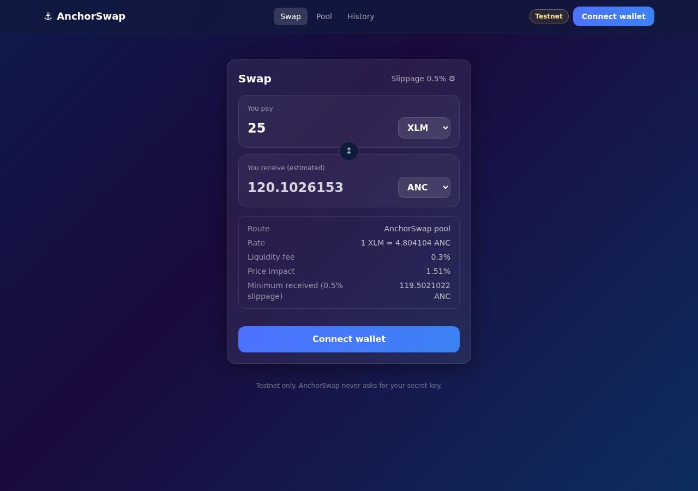
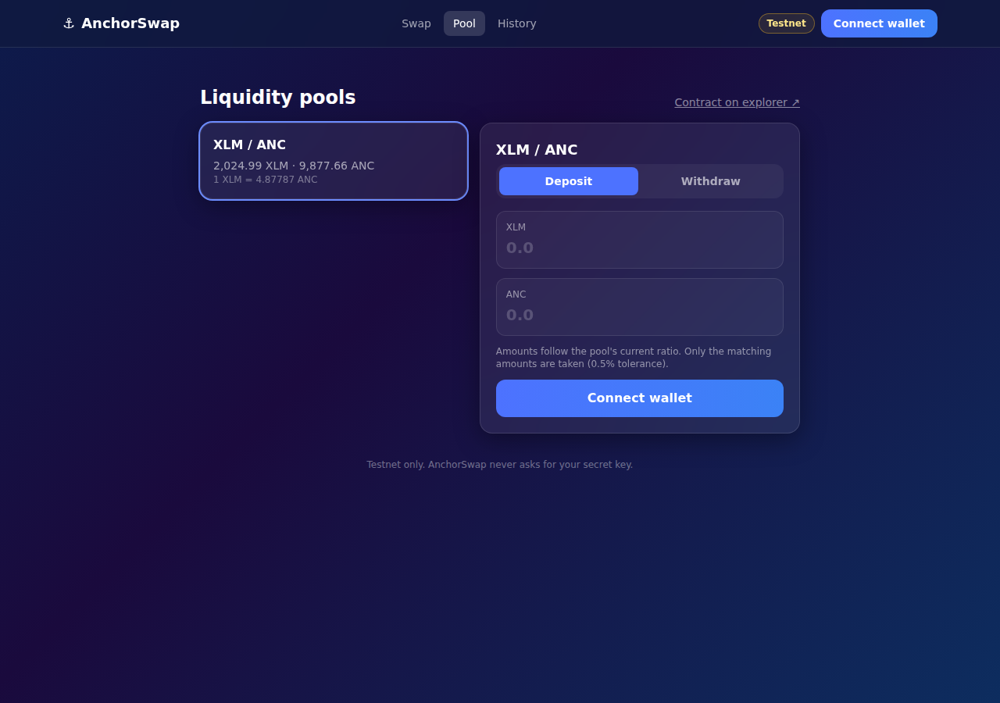
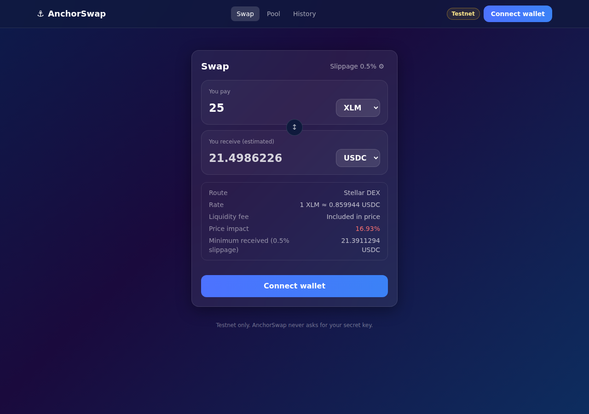
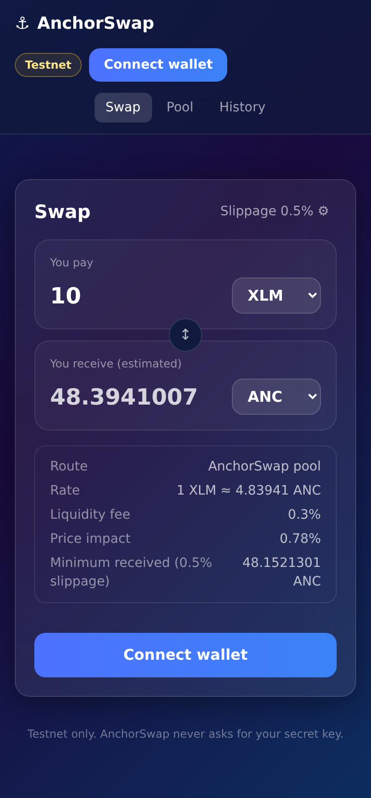

# ⚓ AnchorSwap

A decentralized exchange for Stellar. AnchorSwap has its own constant-product
AMM (a Soroban smart contract) and also routes trades through the Stellar
DEX. Every quote compares both venues and uses the better price.

**Status: working on Stellar Testnet. Not audited and not deployed to
Mainnet.** See [Limitations](#limitations).



## What works

| Feature | How |
|---|---|
| Wallets | Freighter, xBull, Albedo, LOBSTR, Hana and Rabet through [Stellar Wallets Kit](https://stellarwalletskit.dev). The app only ever sees a public key and signed transactions. |
| Network check | The wallet's network is compared with Testnet. Every signature is also verified against the Testnet network ID before sending, which also catches wallets that cannot report their network. |
| Balances | Read from Horizon, with the spendable XLM shown after the account's minimum reserve. |
| Quotes | AnchorSwap: the contract's own `get_amount_out`, simulated on-chain. Stellar DEX: Horizon's strict-send path finder. Nothing is estimated locally. |
| Swaps | AnchorSwap pool (`swap_exact_in`) or Stellar DEX path payment (`pathPaymentStrictSend`). Both enforce a minimum output on-chain. |
| Slippage protection | Default 0.5%, user-adjustable up to 5%. The swap is re-quoted just before signing and stops if the price fell below the confirmed minimum. Price impact over 3% shows a warning; over 15% the swap is blocked. |
| Liquidity | Deposit at the pool ratio, withdraw 25/50/75/100% of a position, and see your share of the pool. |
| Trustlines | Detected automatically, with a one-click "Add trustline" step. |
| Tracking | Success is shown only after Stellar RPC reports the transaction as `SUCCESS`, with a Stellar Expert link. Unconfirmed transactions are re-checked against Horizon. |

## Live testnet deployment

| | |
|---|---|
| AnchorSwap contract | [`CCDHGMQRJOIYI5DT7VCMWDEWRIFVDIIX6NAF3SI2WM3DSHIIFH67LK7T`](https://stellar.expert/explorer/testnet/contract/CCDHGMQRJOIYI5DT7VCMWDEWRIFVDIIX6NAF3SI2WM3DSHIIFH67LK7T) |
| Pool | XLM / ANC (seeded with 2,000 XLM and 10,000 ANC) |
| ANC test asset | `ANC:GA5XZ7UAZDQP3UBJBWBCFLY3L2NFSPUJHQXYX5J7JVZASPDFFWBEP477` |
| Other tokens | XLM (native), USDC (Circle's testnet issuer), traded through the Stellar DEX |

All IDs are in [`frontend/src/config/testnet.json`](frontend/src/config/testnet.json).

### Verified end-to-end run

These testnet transactions were made by `npm run test:testnet` using the
app's own code, with a fresh Friendbot-funded account standing in for the wallet:

| Step | Transaction |
|---|---|
| Add ANC trustline | [d856edaa…](https://stellar.expert/explorer/testnet/tx/d856edaa5a675bec830bcf78df04c7988de1d4bbf2df964faedd8bc1b5d1b105) |
| Swap 25 XLM → ANC (AnchorSwap pool). Quoted and received exactly 121.5830341 ANC | [26e068df…](https://stellar.expert/explorer/testnet/tx/26e068dfbe9f18f7549ddd9502fcd17c55d719153bbc5d2f84db77ed8d9c82db) |
| Swap ANC → XLM (AnchorSwap pool) | [af1c19f9…](https://stellar.expert/explorer/testnet/tx/af1c19f9f82b911a2b797712c2bfadd0dac996250910ea2a79747cbc5eed5536) |
| Swap 5 XLM → USDC (Stellar DEX) | [af6f00da…](https://stellar.expert/explorer/testnet/tx/af6f00daca3aada7c6fd658ba69fde38d453fda9437a02ac81e5851944f04107) |
| Add liquidity | [63ab5c97…](https://stellar.expert/explorer/testnet/tx/63ab5c97acf74333f384e8c0499742e31ef6caab03463715d341b017056c4aaa) |
| Remove liquidity | [524d3aba…](https://stellar.expert/explorer/testnet/tx/524d3abaffef9bec5eaf30e6f9897e26141a5220bf9699c3794e48ce27cd4252) |

Testnet is reset from time to time. After a reset these links stop working
and the contract must be redeployed (see [Deployment](docs/deployment.md)).

## Quick start

Requirements: Node 22+ for the app. For contracts: Rust (stable) with the
`wasm32v1-none` target, and [stellar-cli](https://developers.stellar.org/docs/tools/cli) 25.2 or newer.

```bash
cd frontend
npm ci
npm run dev          # http://localhost:3000
```

The app already points at the live testnet deployment, so no configuration is needed.

### Trying a swap

1. Install [Freighter](https://www.freighter.app/) (or another supported wallet) and switch it to **Testnet**.
2. Open the app and click **Connect wallet**.
3. If the account is new, use the Friendbot link the app shows to get 10,000 test XLM.
4. Pick XLM → ANC and enter an amount. The quote and route appear.
5. Click **Add ANC trustline** (one-time), then **Review swap** → **Confirm swap**, and sign in the wallet.
6. Wait for "Confirmed on-chain", then open the Stellar Expert link to check it yourself.

For XLM → USDC the app routes through the Stellar DEX, because there is no AnchorSwap USDC pool.

## Testing

| Command | What it covers |
|---|---|
| `cargo test` | 30 contract tests: AMM math (incl. a randomized check that `k` never decreases), authorization (non-admin, spending someone else's tokens), slippage, deadlines, pause, minimum liquidity, deposit ratios, events. Uses real Stellar Asset Contracts. |
| `cd frontend && npm test` | 53 unit and component tests: amount parsing, token config, quote routing, transaction submission and confirmation, error decoding, signature/network checks, history, and the full wallet → quote → sign → confirm UI flow with a fake wallet. |
| `cd frontend && npm run test:testnet` | 8 end-to-end tests on the real Testnet: trustlines, both swap routes, a slippage rejection, deposit and withdrawal. Each is confirmed twice (RPC and Horizon) and balance changes are checked. Needs internet; takes about 45 s. |

CI runs the first two on every push, plus lint, type-check and a production
build. The testnet suite can be started by hand from the Actions tab.

## Documentation

- [Architecture](docs/architecture.md): components and data flow
- [Contract and client API](docs/api_reference.md): functions, errors, events
- [Design decisions](docs/design_decisions.md): what was chosen and why
- [Deployment](docs/deployment.md): deploying the contract and hosting the app
- [Environment variables](frontend/.env.example)

## Screenshots

| | |
|---|---|
|  |  |
| Pool page with live reserves | XLM → USDC routed through the Stellar DEX |



These were taken without a wallet extension, because headless browsers
cannot run one. With a wallet connected, balances, the trustline step and
the transaction status appear in the same card.

## Limitations

Read this before calling AnchorSwap production-ready.

- **Not audited.** The contract has thorough tests but has not had an independent security audit. Do not deploy to Mainnet with real funds before one.
- **Testnet only.** The app and contract are configured for Testnet. Mainnet needs a new deployment, real token choices and a reviewed admin setup (see [Deployment](docs/deployment.md)).
- **Single admin key.** The admin can create pools, pause swaps and deposits, and upgrade the contract code. Upgrading can change everything, so on Mainnet the admin should be a multisig or governance contract. Withdrawals cannot be paused.
- **Thin liquidity.** The XLM/ANC pool holds test funds from the deployer, so large trades have high price impact. Testnet DEX liquidity for XLM/USDC is provided by third parties and may be missing or at unrealistic prices.
- **No multi-hop through AnchorSwap pools.** AnchorSwap swaps go directly through one pool; multi-hop routing only happens on the Stellar DEX. Trades are not split across venues.
- **Curated tokens only.** The token list is fixed in code. Users cannot add arbitrary tokens, which prevents look-alike tokens but limits choice.
- **Standard tokens only.** The contract assumes tokens move exactly the amount requested, as Stellar Asset Contracts do. Fee-on-transfer or rebasing tokens would break pool accounting, so pools for them must not be created.
- **History is per browser.** The History page lists transactions made from this browser and re-checks their status on-chain. The full account history is one click away on Stellar Expert.
- **Testnet resets.** Stellar Testnet is wiped periodically, so the deployment will need to be redone afterwards.
- **Dependency advisories.** `npm audit` still reports issues in two places, both checked:
  - packages Stellar Wallets Kit installs for wallets this app does not load (WalletConnect, HOT, NEAR, Solana, Coinbase). A scan of the production bundle finds none of them.
  - Next.js's own pinned PostCSS, which only runs at build time on this repo's CSS.

  Re-check when upgrading those packages.
- **Wallet coverage.** Freighter is the main target. Other wallets connect through Stellar Wallets Kit; those that cannot report their network rely on the signature check instead.

## Security model (summary)

- The app never asks for or handles secret keys. Signing happens in the user's wallet.
- Every swap, deposit and withdrawal has an on-chain minimum and a deadline, so a delayed or front-run transaction fails instead of executing at a worse price.
- Transactions are simulated before signing, so a call that would fail is caught first.
- Contract errors are typed and shown in plain language.
- Only tokens from the fixed list are tradable. Their contract IDs are re-derived from the asset codes at startup, so a tampered config fails loudly.
- Details are in [Design decisions](docs/design_decisions.md).

## License

Apache-2.0
