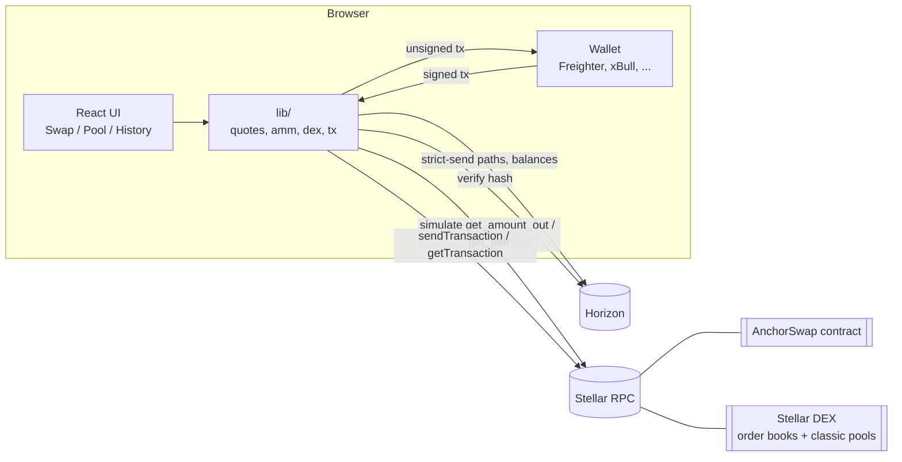

# Architecture

AnchorSwap has three parts:

1. **`contracts/anchorswap`**: a Soroban smart contract that holds many
   constant-product pools in one contract.
2. **`frontend`**: a Next.js app. It runs entirely in the browser and talks
   directly to public Stellar services. There is no AnchorSwap backend.
3. **Stellar services**: Stellar RPC (Soroban simulation, submission,
   results), Horizon (balances, DEX path finding, a second confirmation)
   and the user's wallet (signing).



## Swap, step by step

1. **Quote.** `lib/quotes.ts` asks both venues in parallel:
   - AnchorSwap: simulates the contract's `get_amount_out` through RPC. This is the exact amount the contract would pay out right now.
   - Stellar DEX: Horizon `GET /paths/strict-send`, best path wins.

   Price impact is measured against the pool's spot price (AnchorSwap) or a quote for a 1/1000 slice of the trade (DEX). Quotes refresh every 15 s.
2. **Review.** The user sees the route, rate, fee, price impact and minimum received (`amountOut × (1 − slippage)`, rounded down).
3. **Re-quote.** On confirm, the app fetches a fresh quote. If it fell below the minimum the user approved, it stops and asks again. The minimum sent on-chain is never lower than the one the user confirmed.
4. **Build.**
   - AnchorSwap: `swap_exact_in(user, in, out, amount, min_out, deadline)`. The transaction is simulated and assembled with resource fees and authorization. If the simulation fails (for example on slippage), the user is never asked to sign.
   - DEX: `pathPaymentStrictSend` with `destMin = min_out`.
5. **Sign.** The wallet signs. `assertSignedFor` checks the signature belongs to the connected account and to the Testnet network ID. A wallet set to another network fails here.
6. **Submit and confirm.** `submitAndWait` sends through RPC, then polls `getTransaction` until `SUCCESS` or `FAILED`. Only `SUCCESS` is shown as success. If there is no answer within 90 s, the status stays `pending` and is re-checked against Horizon later.
7. **Record.** The result (hash, ledger, status, error) is saved to the browser's local history.

## Contract layout

```
contracts/anchorswap/src/
├── lib.rs      entry points, events, auth
├── math.rs     pure AMM math (amount_out, deposit, withdraw, isqrt) + tests
├── storage.rs  storage keys, canonical pair ordering, TTL extension
├── error.rs    typed error codes
└── test.rs     contract tests with real Stellar Asset Contracts
```

| Storage key | Tier | Contents |
|---|---|---|
| `Admin`, `Paused` | instance | admin address, pause flag |
| `Pairs` | persistent | list of pools (max 100) |
| `Pair(PairKey)` | persistent | `reserve_a`, `reserve_b`, `total_shares` |
| `Shares(PairKey, Address)` | persistent | one provider's LP shares |

A `PairKey` holds the two token addresses sorted by their XDR bytes, so
`(A, B)` and `(B, A)` are the same pool. Public functions take tokens in
any order and return amounts in the caller's order.

Every entry touched is given a longer lifetime (instance: 30 days;
persistent: 60 days) so active pools are not archived. Ledger entries
for fully withdrawn positions are deleted.

## Frontend layout

```
frontend/src/
├── config/testnet.json   deployed contract IDs (written by deploy script)
├── lib/
│   ├── config.ts         network endpoints, limits
│   ├── tokens.ts         fixed token list, contract IDs derived from assets
│   ├── amounts.ts        exact bigint parsing/formatting, slippage, impact
│   ├── horizon.ts        balances, DEX quotes
│   ├── amm.ts            contract views and tx builders
│   ├── dex.ts            path payment and trustline tx builders
│   ├── quotes.ts         best-route selection
│   ├── tx.ts             signature check, submit, confirm, error decoding
│   ├── history.ts        local tx history, re-checks via Horizon
│   ├── walletAdapter.ts  Stellar Wallets Kit adapter (swappable in tests)
│   └── wallet.tsx        React wallet context, network detection
├── hooks/                useBalances, useQuote, useTxRunner
├── components/           SwapCard, PoolPanel, HistoryList, ...
└── app/                  routes: /, /swap, /pool, /history
```
